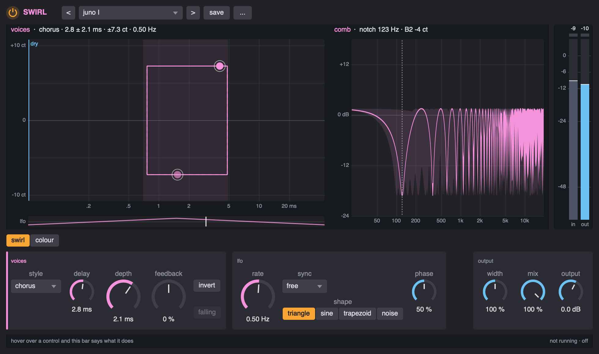

# Swirl

**Chorus, ensemble, dimension, flanger, thru-zero, barber pole and vibrato in one engine of moving delay lines, each mode set up the way one piece of hardware set it up, with the lines and the comb they make drawn live.** A SuperCollider extension.



```supercollider
s.boot;
Ndef(\pad, { Swirl.ar(Saw.ar([110, 110.3, 165]).sum * 0.08 ! 2, \swirl) }).play;

p = Swirl(Ndef(\pad), \swirl);
p.gui;
p.preset = 'juno II';
p.style = \flanger; p.baseTime = 0.0015; p.sweep = 0.008; p.feedback = 0.7;
p.preset = 'barber pole';
```

Every effect of this family lives in the same three places. Write `Swirl.ar` into a graph of your own and drive it from the object, as above; give it a node of its own on a bus, `Swirl.onBus(0, 2).enabled_(true)`; or put it in a chain, `FxChain.master.add(Swirl())`. If SuperDirtGUI is installed, it is an insert on an orbit too: `~sdg.addInsert(0, \swirl)`, listed under *modulation*.

It is built on [FxKit](https://github.com/fracnesco/sc-fx-kit), and the class library will not compile without it; the installer links it when the folders sit side by side. It uses SuperCollider's own UGens, not sc3-plugins.

Written for SuperCollider 3.13 on macOS. Nothing in it is platform specific apart from the symlink in `install.scd`, which Linux shares and Windows does not.

## Install

### As a quark

```supercollider
Quarks.install("https://github.com/fracnesco/sc-swirl.git");
thisProcess.recompile;
```

The manifest names `sc-fx-kit` as a dependency, so `Quarks` fetches that first. The quark goes by the name of the repository, `sc-swirl`; the class inside it is `Swirl`.

### From a clone

Clone `sc-fx-kit` into a folder called `sc fx kit` and this into `sc swirl`, side by side. Open `install.scd` and evaluate its first block, then recompile the class library. It links what is missing and tells you what it did.

On Windows there is no `ln -s`, so use the quark, or copy the three folders into the extensions folder by hand: `Platform.userExtensionDir.openOS` opens it.

Install it one way or the other, **not both**: two copies on the class path is a duplicate class error at compile time.

### Check that it took

```supercollider
Swirl.presetNames;
Swirl.onBus(0, 2).enabled_(true).gui;
```

Select `Swirl` and press cmd/ctrl + d for the help file, and see [examples/swirl-demo.scd](examples/swirl-demo.scd) for a walkthrough you can evaluate a block at a time.

## What it does

A chorus is a copy of the sound a few milliseconds late, whose delay keeps moving. A delay that grows reads the sound more slowly than it was written, so the copy sings flat; one that shrinks reads it faster, so it sings sharp. Mixed with the dry, the moving copy detunes against it, and the two make a comb whose teeth wander. That is the shimmer, and the whole family - chorus, flanger, vibrato - is that one idea with different numbers.

**The cents.** A line's pitch is 1 minus how fast its delay moves. A triangle lfo of depth `a` seconds either side, at `f` Hz, moves the delay `4 a f` seconds every second, so the line sings `4 a f` higher on the way in and as much lower on the way out: two steady detunes that swap every half period, with no wobble between them. That is the Juno's sound. The Juno's 2.1 ms at 0.5 Hz is `4 x 0.0021 x 0.5` = 0.42 %, or 7.3 cents. A sine of the same depth peaks at `2 pi a f` and wobbles all the way; a trapezoid is flatter still. The window's caption works the figure out for you: `chorus · 2.8 ± 2.1 ms · ±7.3 ct · 0.50 Hz`.

**The comb.** A copy `d` seconds late, added to the dry, cancels the frequencies whose half period is `d`: the first notch is at `1 / (2 d)` Hz, and the rest at its odd multiples. At 2-5 ms (a chorus) the notches are many and shallow, and their slow wandering is part of what you hear as width. Under 1 ms swept wide (a flanger) they are few and deep, and their sweep is the jet. Feedback sends the wet back into its own line and turns the notches into ringing peaks: up for peaks on the harmonics, down for a hollow, odd comb.

### The modes

`style` picks one. Every mode reads the same knobs; a knob a mode ignores is dimmed.

| style | lines a side | what it is | after |
|---|---|---|---|
| `chorus` | 1 | one line on one triangle, the right side's lfo upside down (`lfoPhase` 50 %), feedback allowed | Roland Juno-60/106 |
| `ensemble` | 3, 120 degrees apart | a slow lfo for the swirl, an optional fast one (`fastDepth`) for the shimmer; with a sine the three voices' mean pitch stands still | Solina, Roland RS-202/505, the Tri-Stereo Chorus |
| `dimension` | 1 | long delays (7.5-10 ms), small slow sweeps: width without audible pitch; `lowCut` keeps the bass dry and `cross` decorrelates the sides | Roland SDD-320 Dimension D |
| `flanger` | 1 | a short line swept exponentially, so the notches move evenly in pitch; feedback both ways; `sweep` 0 freezes the comb | A/DA Flanger, Electric Mistress, MXR 117 |
| `thruzero` | 1 | the dry delayed too, the wet crossing it; with `invert` on, the sound vanishes at the crossing | two tape machines, a hand on the reel |
| `barberpole` | 4 on one saw | each line fades in, sweeps an octave and fades out before the next takes over: notches that climb (or, with `falling`, fall) for ever | Esqueda and Välimäki's barberpole flanger (DAFx-15) |
| `vibrato` | 1 | only the moving copy, no dry; its swing set in cents (`cents`) whatever the rate, down to the slow rates where it would need more than 10 ms of delay either side (under 0.23 Hz at 25 cents on a sine; the caption then shows the real swing) | a singer's vibrato, Dattorro's vibrato |

The style menu is append-only: node maps and SuperDirtGUI sessions carry its index, so a new mode (a phaser, one day) can only come after `vibrato`.

**Thru-zero makes the sound late.** The dry is delayed with the wet, by `baseTime` clipped to 0.5-5 ms, so the whole insert is that late (4 ms in 'tape flange'). Nothing compensates for it on an orbit in SuperDirt.

**Colour.** `analog` is the bucket-brigade chips: the Juno's filters round the line, a compander that breathes, and a soft ceiling that only saturates loud input. The compander is exact on a steady sound, but like the chips' it dulls a hit after silence: a kick through vibrato (the wet alone) loses 4.2 dB of its peak at `analog` 0.7, which every juno preset uses, and 6.9 dB at 1 (more in its first 5 ms). In the other modes the dry carries the attack; on drums in vibrato keep `analog` low. `noise` is their hiss, which is there only while sound comes in (at 100 % about -50 dBFS) and closes a few seconds after it stops. `lowCut` (a high pass before the lines) and `hiCut` (a low pass on the wet) shape what the lines get. At their floors - `lowCut` 20 Hz, `hiCut` 20 kHz, `analog` 0, `noise` 0 - each of these stages is out of the path bit for bit, so "off" means off.

**Every preset is level-matched to the dry on broadband sound**: on pink noise within 1 dB, except dimension 1-3 (1.3 dB under) and tape flange (3.3 dB under). A trim lifts everything, the comb's peaks too, so it stops where those peaks would rise more than 3 dB over the input; without that, tape flange (whose notch takes the bass away) put a tone out 6.7 dB louder than it came in. On a tone or a chord no trim can hold, since a comb lifts some frequencies and cuts others: measured against the dry, presets run from -8.3 dB (filter matrix) to +0.3 dB on a saw pad, from -10.8 dB (barber pole) to +4.4 dB (filter matrix, its feedback ringing on the tone) on a 1 kHz sine, and from -7.0 to +0.7 dB on drum hits. So switching a preset on does not simply make broadband sound louder; on a held note, trust your ears. The Juno's own jump in level when its chorus was switched on is deliberately not reproduced.

**The delay never jumps.** A jump in a delay is a click, and a flanger's delay moving too fast is a pitch bend; that is the one thing this effect has to get right. A change of `style`, `lfoShape`, `lfoSync`, `invert` or `falling` dips to the dry for 24 ms and happens at the bottom of the dip, which is what lets a Tidal pattern change them event by event. The other settings glide wherever a jump would be heard: `baseTime` and `sweep` move at most 0.025 seconds a second (a delay moving that fast sings 2.5 %, 44 cents, off, so 1 to 10 ms takes 0.36 s), vibrato's delay at most a quarter faster than its own swing (its depth in seconds goes as 1 / rate, so a new rate would otherwise chirp), `lowCut` and `hiCut` in octaves over about 0.15 s, `analog` over 0.4 s, the feedback over 0.15 s and `lfoPhase` over 0.3 s; a style without feedback fades the old resonance out on the dip's way down. A new node starts at its own settings, not at a chorus for its first block, and a synced lfo that hears the clock a little off glides back over 150 ms instead of stepping.

Measured offline (an NRT render per case, 48 kHz, the numbers read back with numpy): every line's delay equals the class's model to 7.5e-9 s; 'juno I' sings +7.23 and -7.28 cents on a 1 kHz sine, 'juno II' +12.02 and -12.11, 'vibrato' +25.0 and -25.4 at a 0.182 s period; a still 1 ms flanger has its notches at 500, 1500 and 2500 Hz, 64-72 dB deep; thru-zero with `invert` nulls to exactly 0; every preset not held by the peak cap is within 0.73 dB of the dry on pink noise; switching modes or sync mid-note steps no more than the sine itself does, and so does a jump of any continuous setting (`lowCut` 30 to 2000 Hz once rang to +8 dB, a vibrato rate change chirped up to 17 semitones); at the floors each side's wet is a plain `DelayC` to 0.0.

## The window

`p.gui` opens it (`p.panel(view)` puts the same thing in a view of yours): the top row (on, presets, save, the menu with copy and paste), the display with the in and out meters beside it, and the cards under it on two pages. Hover over anything and the bar at the bottom says what it does.

Left in the display are **the voices**: every delay line as it moves over one lfo period, its delay along (ms, on a log scale) and the pitch it sings at up (cents). So each line draws a closed path: the Juno's triangle two flat lines at plus and minus its cents joined by jumps, a sine an ellipse, the ensemble three loops a side, the barber pole lines that fade in and out, vibrato an ellipse at the left edge. The left side's lines are solid, the right side's dashed. The blue line is the dry (at its delay in thru-zero, where the dry is late too) and the faint band the range the lines sweep. The dots are where each line is now, as big as it is loud; the ring round each side's first dot is that side's wet level. Under it, the lfo over one period, with where it is now. The caption over it says the mode and its numbers.

Right is **the comb**: what the lines do to the spectrum now (the left side), a faint band where the notches travel as the lfo goes round, and the output's spectrum behind. A chorus is a comb too, a shallow one whose teeth wander. Its first notch, or its first peak with feedback in the flanger, is named with its note: 'filter matrix' reads `peak 500 Hz · B4 +21 ct`.

The paths, the bands, the comb and the caption are worked out from the settings, with the same formulas as the sound. The dots, the playhead, the rings and the spectrum are what the server measures, and move only while the window runs and the effect is on. A synced lfo's cents in the caption are worked out at Tidal's default 0.5625 cycles a second (`SwirlView.cps`), since the object does not know the clock; the dots are the server's.

| in the display | does |
|---|---|
| drag the voices along | `baseTime`, on a log scale |
| drag the voices up and down | `sweep` (`cents` in vibrato) |
| the wheel on the voices | `lfoPhase` |
| drag the comb along | `baseTime`, so the first notch follows the pointer |
| drag the comb up and down | `feedback`, in chorus, flanger and barber pole only |
| the wheel on the comb | the depth |
| drag the lfo strip along | `lfoRate` (free only) |
| the wheel on the lfo strip | the next shape |
| shift | fine, a tenth as far |
| double click | the voices: delay and depth back; the comb: feedback 0; the strip: the rate back |

The cards, page *swirl*: *voices*, in the family's orchid-rose - style, delay, depth (the depth in ms becomes the depth in cents in vibrato), feedback, invert and falling; *lfo* - rate, sync, shape and phase. Page *colour*: *strings* - the fast lfo's depth and rate; *colour* - low cut, hi cut, analog, hiss; *stereo* - cross. *output* - width, mix and output - closes both pages.

## Presets

Built in, by index: 0 default, 1 juno I, 2 juno II, 3 juno I+II, 4 dimension 1, 5 dimension 2, 6 dimension 3, 7 string machine, 8 tri chorus, 9 jet flanger, 10 filter matrix, 11 tape flange, 12 barber pole, 13 vibrato, 14 doubler.

The list is append-only, like the table and the style menu: from Tidal, `n` picks a preset by its index, so `# n 9` keeps meaning 'jet flanger'.

| preset | what it is |
|---|---|
| juno I, juno II | the Juno-60's two buttons: 0.5 and 0.83 Hz triangles, ±7.3 and ±12.0 cents, analog and a little hiss |
| juno I+II | the Juno-6's two buttons together: an 8 Hz sine, not inverted, a mono wobble of ±30 cents |
| dimension 1, 2, 3 | three of the SDD-320's four buttons: ±3.5, ±4.3, ±5.2 cents, the bass dry, the sides cross-fed |
| string machine | the ensemble with its fast lfo: ±3.3 cents slow and ±19.5 at 6 Hz per line |
| tri chorus | three lines a side on a sine, no fast lfo: the mean pitch stands still |
| jet flanger | 0.24-9.5 ms, positive feedback: the first notch from 53 Hz to 2.1 kHz |
| filter matrix | the flanger with its sweep off: a still comb with peaks at 500, 1000, 1500 Hz (B4 +21 cents); `baseTime` tunes it |
| tape flange | thru-zero on the noise shape: wandering crossings and full nulls, 4 ms late |
| barber pole | 1-2 ms, rising for ever, 12.5 s a sweep |
| vibrato | a singer's 5.5 Hz, ±25 cents |
| doubler | one copy 20 ms late a side whose delay wanders slowly: automatic double tracking |

Yours go in `Platform.userAppSupportDir/swirl-presets.scd`: `p.saveAsPreset("mine")`, or press save in the window and give it a name. `p.copySettings` and `other.pasteSettings` carry settings from one to another.

## In SuperDirtGUI and Tidal

`~sdg.addInsert(0, \swirl)` puts it on orbit 0. A Tidal pattern can then play every parameter but `output` (`Swirl.tidalParams`), event by event, once its words are in Tidal's boot file - SuperDirtGUI's `examples/tidal/make-fx-words.scd` writes them:

```haskell
d1 $ s "swirl" # style "<chorus flanger>" # feedback 0.6 # lfoSync "two"
d2 $ s "swirl" # n 9                     -- preset 9, 'jet flanger'
```

With `lfoSync` on anything but `free`, the lfo makes one period every so many of Tidal's cycles, locked to the cycle: `four`, `two`, `one`, `half`, `quarter` down to `sixteenth`, and `third`, `sixth`, `twelfth`. SuperDirtGUI tells it the tempo and the cycle (`Swirl.usesTidalClock`). A Swirl you run yourself takes them as the controls `fxCps`, `fxCycle` and the trigger `fxSync`, FxKit's shared clock (`FxLfo`); told nothing, it runs at 0.5625 cycles a second (135 bpm at four beats a cycle), locked to no one's cycle.

## Parameters

Every parameter is a property: `p.sweep`, `p.sweep = ...`. These also work by name, `p.set(\sweep, ...)`, `p.get(\sweep)`. Knobs clip to their range. This table is generated from the class.

| parameter | section | range | default | what it does |
|---|---|---|---|---|
| `style` | voices | chorus ensemble dimension flanger thruzero barberpole vibrato | chorus | which kind of swirl: chorus, ensemble, dimension, flanger, thru-zero, barber pole, vibrato |
| `lfoRate` | lfo | 0.01 .. 20 Hz | 0.5 | how fast the lines move, when free |
| `lfoSync` | lfo | free four two one half quarter eighth sixteenth third sixth twelfth | free | free at its rate, or one period every so many cycles of Tidal's clock |
| `lfoShape` | lfo | triangle sine trapezoid noise | triangle | triangle = two steady detunes (Juno), sine = a wobble, trapezoid = steadier still, noise = hands on tape reels |
| `lfoPhase` | lfo | 0 .. 1 | 0.5 | how far apart the sides move: 50 is opposite (Juno, Dimension), 0 together (more comb, no width) |
| `baseTime` | voices | 0.0002 .. 0.03 s | 0.0028 | the lines' middle delay: short = flanger, 2-5 ms = Juno, 7-10 ms = Dimension; in thru-zero the latency (0.5-5 ms) |
| `sweep` | voices | 0 .. 0.01 s | 0.0021 | how far each line moves either side of the delay; the caption shows the cents it gives |
| `cents` | voices | 0 .. 100 ct | 25 | vibrato: the pitch swing in cents, whatever the rate (at slow rates, as much as 10 ms of delay allows) |
| `feedback` | voices | -0.95 .. 0.95 | 0 | flanger, chorus, barber pole: the wet back into its line - up = ringing peaks, down = hollow (unlike the family's other feedback knobs, this one goes both ways) |
| `invert` | voices | on off | false | the wet upside down: the notches move (flanger), the null at the crossing (thru-zero) |
| `falling` | voices | on off | false | barber pole: notches that fall for ever instead of rising |
| `fastDepth` | strings | 0 .. 0.0005 s | 0 | a second, fast lfo on every line: the string machine's shimmer (chorus, ensemble, dimension) |
| `fastRate` | strings | 2 .. 10 Hz | 6 | the fast lfo's speed: 5-6.5 Hz in the string machines |
| `lowCut` | colour | 20 .. 2000 Hz | 20 | a high pass before the lines: the bass stays dry and centred (Dimension's 80 Hz) |
| `hiCut` | colour | 1000 .. 20000 Hz | 20000 | a low pass on the wet: darker voices |
| `analog` | colour | 0 .. 1 | 0 | bucket-brigade character: the Juno's filters, a compander that breathes, soft saturation |
| `noise` | colour | 0 .. 1 | 0 | the hiss of the chips, only while sound comes in (100 % = about -50 dBFS) |
| `cross` | stereo | 0 .. 1 | 0 | each side gets the other's wet upside down: wider; at 100 the effect vanishes in mono (mono-safe) |
| `width` | output | 0 .. 2 | 1 | mid/side width of the result: 0 mono, 100 as it is, 200 sides doubled |
| `mix` | output | 0 .. 1 | 1 | how much of the effect goes out, against the dry signal |
| `output` | output | -36 .. 24 dB | 0 | the level of the whole thing, in dB |

`mix` blends the box - the mode's own dry and wet in the hardware's proportion, already level-matched - against the plain dry. At 100 % a preset sounds like the box; vibrato under 100 % becomes a chorus again.

## Channels and cost

It works on channels in pairs: each pair is a left and a right side, with `cross` and `width` between them. An odd last channel gets the left side's lines on its own, with no cross and no width. A mono sound on one channel stays mono; give it as two (`sig ! 2`) to hear the width.

A stereo pair is 758 UGens (one channel 463, four 1246), and costs about 2.5-3 % of the server on this machine (48 kHz, eight stereo instances measured with `s.avgCPU`: 2.51 %, 2.94 % and 2.69 % in three runs). That is fine for a pad or two; a Swirl on every orbit is not what it is for.

**Four channels and more need more wire buffers than a stock server has.** One and two channels fit in the default 64; four need up to 96, six up to 128. Otherwise the SynthDef fails to load with "exceeded number of interconnect buffers". Before booting:

```supercollider
s.options.numWireBufs = 128;
```

Not in this version: a phaser (a chain of allpasses, a different engine; it can come later as an eighth style), an envelope follower on the sweep, and a voices count (each mode has the number of lines its hardware had, on purpose).

## Files

| file | what it is |
|---|---|
| [classes/Swirl.sc](classes/Swirl.sc) | the parameters, the presets, the DSP, and the model the display and the checks read |
| [classes/SwirlView.sc](classes/SwirlView.sc) | the window's display: the voices, the comb, the lfo strip |
| [HelpSource/Classes/Swirl.schelp](HelpSource/Classes/Swirl.schelp) | the help file |
| [HelpSource/Classes/SwirlView.schelp](HelpSource/Classes/SwirlView.schelp) | the help file for the display |
| [examples/swirl-demo.scd](examples/swirl-demo.scd) | a walkthrough, one block at a time |
| [install.scd](install.scd) | the symlink, a check, an uninstall |
| [sc-swirl.quark](sc-swirl.quark) | the quark manifest |
| [images/](images/) | the screenshots in this README |

## License

MIT - see [LICENSE](LICENSE).
